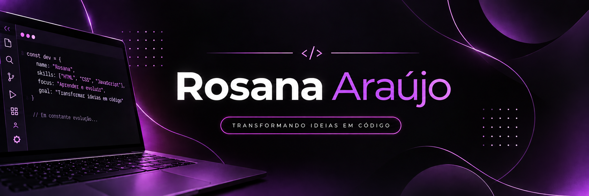

### 💜 Ciência da Computação | Desenvolvimento de Sistemas | Tecnologia

*Transformando ideias em soluções digitais.*

---

## 👩‍💻 Sobre mim

Olá! Eu sou **Rosana Araújo**! 💜

🎓 Estudante de **Ciência da Computação**, apaixonada por tecnologia, inovação e desenvolvimento de sistemas.

Gosto de transformar ideias em projetos reais, desde o levantamento de requisitos e planejamento até o desenvolvimento de interfaces e funcionalidades.

- 💻 Desenvolvendo projetos com **React, JavaScript, Node.js e C#**
- 🧠 Interesse em **Análise de Sistemas, Engenharia de Software e Gestão de Produtos**
- 🎨 Gosto de criar interfaces modernas e intuitivas
- 📋 Experiência acadêmica com documentação de requisitos, casos de uso e organização de projetos
- 🚀 Sempre buscando aprender novas tecnologias e aprimorar minhas habilidades

---

## 🛠️ Tecnologias e ferramentas

### 📚 Atualmente estudando

---

## 🚀 Projetos em destaque

### 📚 Questio — Plataforma Educacional

Plataforma voltada à criação e correção de provas, com gerenciamento de resultados e histórico.

**Tecnologias:** React, Vite, JavaScript e CSS.

**Minha atuação:** Desenvolvimento de interfaces, navegação e experiência do usuário.

### 📡 IP Monitor — Monitoramento de Redes

Aplicação desktop para monitoramento de máquinas e endereços IP.

**Tecnologias:** C#, Windows Forms e .NET.

**Funcionalidades:** Verificação de ping, dashboard, histórico, filtros e alertas.

### 🎓 UniTrack — Gestão de Projetos Acadêmicos

Sistema planejado para acompanhar a evolução dos projetos universitários.

**Funcionalidades previstas:** Gestão de tarefas, prazos, notas acadêmicas e pontuações por atividades.

**Foco:** Organização, produtividade e acompanhamento de projetos.

### 💅 Studio Miriele Souza — Gestão e Agendamentos

Projeto de sistema para gerenciamento de um estúdio de beleza.

**Funcionalidades planejadas:** Agendamentos, notificações, cadastro de clientes e pedidos de produtos home care.

**Foco:** Análise de requisitos, experiência do usuário e soluções de negócio.

### 🍫 Nana Sweets — Doceria Digital

Projeto de site para uma doceria, com catálogo de produtos e carrinho de compras.

**Funcionalidades planejadas:** Vitrine digital, seleção de produtos e finalização de pedidos pelo WhatsApp.

**Foco:** Desenvolvimento web e experiência de compra.

### 🎫 NassauTickets — Sistema de Chamados

Projeto acadêmico de gerenciamento de chamados e organização do atendimento.

**Minha atuação:** Documentação de requisitos e casos de uso.

---

## 📊 Estatísticas do GitHub

---

## 💡 Além do código

Acredito que desenvolver software não é apenas programar.

É compreender problemas, identificar necessidades, planejar soluções e criar experiências que realmente façam a diferença.

Tenho interesse tanto na parte técnica quanto na organização e no desenvolvimento de produtos digitais.

---

## 📫 Contato

---

### 💜 Obrigada pela visita!

*Entre ideias, códigos e desafios, sigo aprendendo e construindo meu caminho na tecnologia.*

