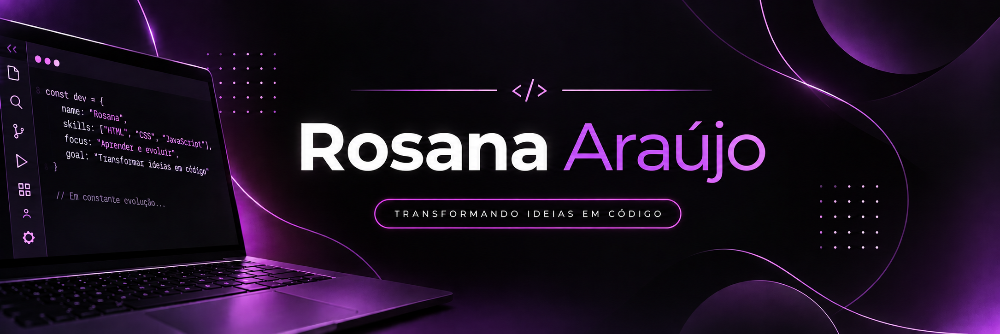

# 💜 Olá, eu me chamo Rosana!

### Desenvolvedora em formação | Apaixonada por tecnologia

✨ Transformando ideias em código e aprendendo algo novo todos os dias.

---

### 👩‍💻 Sobre mim

- 🎓 Estudante de desenvolvimento de software
- 💻 Aprendendo e desenvolvendo projetos com React, JavaScript e Node.js
- 🎨 Interesse em desenvolvimento Front-end e interfaces modernas
- 🚀 Sempre buscando evoluir na programação

### 🛠️ Tecnologias

### 📂 Projetos

- **Questio** — Plataforma educacional para criação e correção de provas.
- **NassauTickets** — Sistema de gerenciamento de chamados.
- **Monitor de IP** — Aplicativo Windows para monitoramento de rede (em desenvolvimento).

---

💜 Feito com dedicação e muita vontade de aprender!

